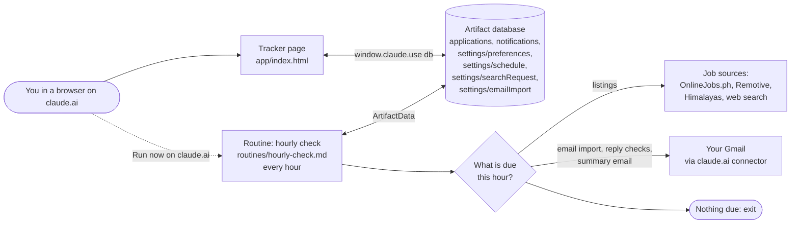

# Job Hunt Tracker

Job Hunt Tracker is a single-page job search tracker that runs as a private claude.ai Artifact. One Claude Code routine runs every hour and, based on a schedule you set on the page, finds new listings, watches your Gmail for employer replies, and emails you a daily summary. It is for one person tracking their own job search.

## Features

- Listings view: job cards with match score, "why it fits" note, Added and Posted dates, and Apply / Skip buttons.
- Find jobs now: ask for a listings search on demand instead of waiting for the daily search. A progress bar shows while the search is requested or running.
- Multi-source listings search: OnlineJobs.ph, the Remotive and Himalayas remote job feeds, and a web search that covers LinkedIn, Indeed, JobStreet, Glassdoor, Kalibrr, company career pages and applicant tracking system (ATS) pages.
- Last search report: which sources worked, how many candidates were found, added, already tracked, closed, too old or mismatched, and up to 15 near misses you can add with **Add to Listings**.
- Duplicate protection: the search never suggests a job you already track or skipped, the Listings view shows only the newest copy of a duplicated job, and the page refuses to add a duplicate by hand or from a near miss.
- Import applications from email: during reply-check hours, the routine reads application confirmation emails in your Gmail (LinkedIn, Indeed, JobStreet, Kalibrr, OnlineJobs.ph and ATS pages such as Greenhouse, Lever, Workable and Ashby) and adds jobs you applied to outside the tracker straight to Applied, tagged "From email". A matching listing or skipped job moves to Applied instead of being added twice. The first scan covers the last 21 days.
- Applied view: a table of every application with a status picker (Applied, Responded, Interview, Offer, Rejected, No reply) and status filter chips.
- Pipeline strip: counts and rates for Applied, Responded, Interview and Offer.
- Follow-up reminders: any job still in Applied 7 or more days after you applied shows up under the bell.
- Notifications bell: new listings, employer replies and daily summaries written by the routine, with unread counts.
- Search preferences: job titles, locations, level, salary floor, keywords and excluded companies. The listings search reads these.
- Schedule: choose your time zone, the hours when Claude checks for replies, and the hours for the listings search and the daily summary.
- Manual add, edit and delete for any job, with a status history per job.
- Skipped jobs drawer with Restore, and Undo after Apply or Skip.
- Light and dark themes that follow your system setting.

## How it works

The page is one HTML file (`app/index.html`) with inline CSS and plain JavaScript. It has no framework and no build step on purpose: it is a small single page with one `render()` function, so there is nothing to install or keep up to date.

The page stores everything in the Artifact's built-in database, which it opens with `window.claude.use("db")`. The routine is a Claude Code scheduled cloud routine, defined in `routines/hourly-check.md`. It runs in Anthropic's cloud, so it keeps working when your computer is off. It reads and writes the same database through the `ArtifactData` tool, searches the web for listings, and uses the claude.ai Gmail connector to read replies and send you email.

The routine runs every hour. Each run first reads `settings/schedule` and `settings/searchRequest` from the database and works out which tasks are due in your time zone:

- Listings: at your listings hour, or whenever a **Find jobs now** request is pending.
- Import from email: every hour inside your reply-check window, unless you turn it off.
- Reply checks: every hour inside your reply-check window.
- Summary: at your summary hour.

If nothing is due, the run stops straight away. This is why you change timing from the page's **Schedule** dialog, not by editing the routine.



A listings run gathers candidates from every source, records how each source did, and opens each posting to classify it as a duplicate, closed, old, mismatched, unverified or good. It adds the good ones as listings and keeps up to 15 near misses (old, mismatched on one rule, or unverified). It writes the outcome to `settings/searchRequest.report` on every listings run, scheduled or requested, and the page shows it in the **Last search** block.

More detail:

- [Data model](docs/data-model.md): every collection, field, type and allowed value.
- [Routines](docs/routines.md): what the hourly routine does, how it decides what is due, and how to create or change it.
- [Deployment](docs/deployment.md): publishing and updating the page, setting preferences and the schedule, creating the routine.

## Getting started

### Prerequisites

- A claude.ai account with access to Artifacts and Claude Code, including scheduled routines.
- Claude Code installed, or access to claude.ai/code in a browser.
- The Gmail connector enabled on your claude.ai account (needed for the email import, reply checks and the summary email).
- A cloud environment for the routine whose network access allows job sites (Full, or Custom with the job board domains you want searched). See [Deployment](docs/deployment.md#allow-network-access-to-job-sites).

### Setup

1. Get a copy of this repository.

   ```bash
   git clone <YOUR_REPO_URL>
   cd job-tracker
   ```

2. In Claude Code, from the repository folder, ask Claude to publish `app/index.html` as a private Artifact with the `db` and `user` capabilities. Copy the artifact URL it gives you. This is your `<YOUR_ARTIFACT_URL>`. See [Deployment](docs/deployment.md#publish-the-page) for details.
3. Open the artifact URL on claude.ai while signed in. Select **Preferences**, enter at least one job title, and select **Save preferences**.
4. Select **Schedule**, choose your time zone and hours, and select **Save schedule**. If you skip this step, the routine uses the defaults listed under [Configuration](#schedule).
5. Create the routine from `routines/hourly-check.md`, replacing `<YOUR_ARTIFACT_URL>` with your artifact URL and `<YOUR_EMAIL>` with your Gmail address (for example `you@example.com`). Schedule it to run every hour. See [Routines](docs/routines.md#create-the-routine).
6. Store the routine's URL (`<YOUR_ROUTINE_URL>`) in `settings/schedule.routineUrl` so the page can show a **Run it now on claude.ai** link. See [Deployment](docs/deployment.md#store-the-routine-url).
7. Optional: select **Find jobs now** on the Listings tab, then select **Run it now on claude.ai** and **Run now** on the routine page to fill the Listings view straight away.

## Usage

- Review the last search: the **Last search** block on the Listings tab shows when the last listings run finished and its counts (Found, Added, and when non-zero Already tracked, Closed, Too old and Didn't match). Expand it to see each source with its result (No results, Blocked or Error are labelled, with a note for blocked or failed sources) and the near misses.
- Add a near miss: in **Last search**, under **Near misses**, select **Add to Listings**. The job is added as a listing with its "why it fits" note set to "Near miss: <reason>". If the job is already tracked, the row shows "Already in your tracker" with its status instead of the button. The first 15 near misses show; select **Show all** if there are more.
- Review new listings: open the Listings tab. Each card shows the company, role, the date it was added and, when known, the date it was posted, plus location, salary, match score and why it fits. Select **View posting** to read the original.
- Find jobs now: on the Listings tab, select **Find jobs now**. The routine picks up the request at its next hourly run. For results in a few minutes, select **Run it now on claude.ai**, then select **Run now** on the routine page. The line under the button shows whether the search is requested, running, done (with the number of new listings) or failed. The button is disabled until you save search preferences, and while a request is pending or running. A request with no progress after 2 hours can be made again.
- Apply to a job: select **Apply** on a card. The posting opens in a new tab, and the card moves to Applied. The applied date is set to today only if the job does not already have one. You still submit the application yourself on the employer's site. Select **Undo** in the toast to move it back.
- Skip a job: select **Skip**. Skipped jobs collect in the drawer at the bottom of the page, and the listings search will not suggest them again. Select **Restore** to bring one back.
- Track progress: in the Applied tab, change a job's status from the status picker. Filter with the chips above the table.
- Handle follow-ups: open the bell. Under **Follow-ups due**, select **Mark followed up** after you chase an employer, or **No reply** to mark the job as ghosted.
- Read notifications: open the bell and select a notification to mark it read and jump to the job it refers to. **Mark all read** clears the unread count.
- Change when Claude runs: select **Schedule**. The current schedule is shown under the page title.
- Add a job by hand: select **Add job**, fill in at least Company and Role, choose a status, and select **Save**. If the job matches one already in the tracker (same posting URL, or same company and role), the form shows "This job is already in your tracker" with a **Show it** link and does not save.
- Edit or delete a job: select the company name on a card or table row. To delete, select **Delete** and then **Click again to delete**.
- Search: type in the search box to filter by company, role or location.

## Configuration

Configuration lives in two database documents, each edited from a dialog on the page. The routine reads both on every run.

### Search preferences

The `settings/preferences` document, edited from the **Preferences** dialog.

| Setting | Default | What it changes |
| --- | --- | --- |
| Job titles (`roles`) | empty | Titles to search for. The listings search does nothing while this is empty. |
| Locations (`locations`) | empty | Places to search in. |
| Remote roles are fine (`remoteOk`) | off | Also include remote roles. |
| Level (`level`) | `any` | Seniority filter: `any`, `entry`, `mid`, `senior`, `lead`. |
| New listings per day (`maxPerDay`) | 10 | Maximum listings added per search, 1 to 50. |
| Minimum salary (`salaryMin`) | empty | Salary floor, applied only when a posting shows a salary. |
| Currency (`salaryCurrency`) | empty | Three-letter currency code for the floor, such as `USD`. |
| Must mention (`includeKeywords`) | empty | Postings that mention these are preferred. |
| Skip if it mentions (`excludeKeywords`) | empty | Postings that mention any of these are dropped. |
| Skip these companies (`excludeCompanies`) | empty | Companies that are never suggested. |

Enter multiple values separated by commas.

### Schedule

The `settings/schedule` document, edited from the **Schedule** dialog. All hours are whole hours (0 to 23) in the chosen time zone. Changes apply from the next hourly run.

| Setting | Default | What it changes |
| --- | --- | --- |
| Time zone (`timezone`) | `Asia/Shanghai` | IANA time zone used for every hour below and for "today" in the routine. |
| Check for replies every hour (`updatesEnabled`) | on | Turns Gmail reply checks on or off. |
| From (`updatesFrom`) | 8 (8:00 AM) | First hour of the reply-check window. |
| To (`updatesTo`) | 23 (11:00 PM) | Last hour of the reply-check window, inclusive. If From is later than To, the window wraps past midnight. If they are equal, replies are checked once a day. |
| Import applications from email (`importEnabled`) | on | Turns the Gmail import of application confirmation emails on or off. It runs during reply-check hours. |
| Find new listings daily (`listingsEnabled`) | on | Turns the daily listings search on or off. **Find jobs now** works either way. |
| Listings at (`listingsHour`) | 8 (8:00 AM) | Hour of the daily listings search. |
| Send a daily summary (`summaryEnabled`) | on | Turns the summary email on or off. |
| Summary at (`summaryHour`) | 21 (9:00 PM) | Hour of the summary email. |

The document also holds `routineUrl`, which the dialog does not show. You or Claude set it once after creating the routine; see [Deployment](docs/deployment.md#store-the-routine-url).

### Fixed settings

- Duplicate matching: two jobs are the same if either key matches. The URL key is the host without `www.` plus the path without a trailing slash, lowercased, with the query string and hash removed. The name key is `company|role`, lowercased, with punctuation removed and spaces collapsed.
- Near misses: the routine saves up to 15 per run.

- Follow-up reminder delay: 7 days (`FOLLOW_UP_DAYS` in `app/index.html`).
- Re-request window for a stuck search: 2 hours (`SEARCH_STALE_MS` in `app/index.html`).
- The routine itself runs every hour. Only what it does each hour is configurable from the page.

## Project structure

```text
job-tracker/
  README.md                         This file
  LICENSE                           MIT license
  .gitignore                        OS and editor files to ignore
  app/
    index.html                      The whole tracker page: HTML, CSS and JavaScript
  routines/
    hourly-check.md                 Prompt for the hourly routine (listings, email import, replies, summary)
  docs/
    data-model.md                   Database collections and fields
    routines.md                     Routine behavior, schedule logic and setup
    deployment.md                   Publishing the page and creating the routine
```

## Limitations and known issues

- The page only works inside claude.ai while you are signed in. Opened as a plain local file, it loads but shows "Saving isn't available in this view." and cannot read or save data.
- Nothing is instant. The routine runs once an hour (the minimum routine interval), and the scheduler may start it some minutes past the hour (for example at :08). A reply can take about an hour to appear, and replies that arrive outside your reply-check window show up at the next check inside it.
- **Find jobs now** only records a request. Unless you run the routine by hand, results arrive at the next hourly run.
- Schedule hours are whole hours only. You cannot pick 8:30.
- The listings search depends on which job pages Claude can reach. If the routine's cloud environment has no network access to job sites, Claude cannot open postings to verify them, so most results appear as unverified near misses instead of listings.
- JobStreet and Indeed block automated access (HTTP 403) whatever the network setting, so they usually show as Blocked in the report. Other boards may block access or require sign-in too, so results vary and may miss postings you would find yourself.
- Duplicate matching is by URL and by company and role name. The same job posted under a different URL and a differently worded title is not detected. The page hides older duplicate listings from view but does not delete them.
- Claude cannot submit applications. **Apply** only opens the posting in a new tab and moves the card to Applied.
- Routine emails are sent from your own Gmail account to your own address, so they appear as messages from yourself.
- Dates written by the page use your browser's local date, while the routine uses the time zone from the schedule. If they differ, "today" can differ between the page and the summary email around midnight.

## License

MIT. See [LICENSE](LICENSE).
