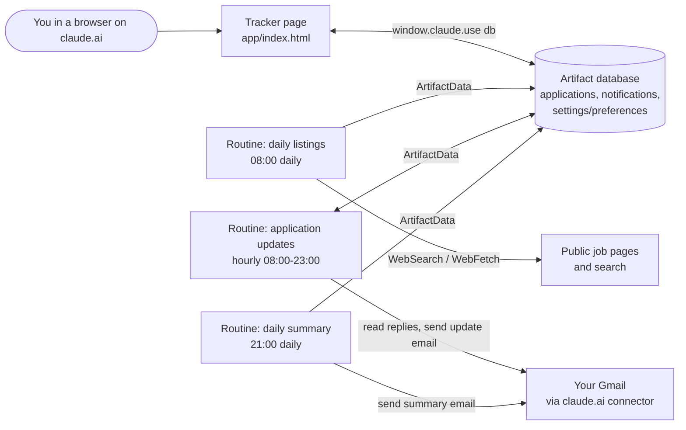

# Job Hunt Tracker

Job Hunt Tracker is a single-page job search tracker that runs as a private claude.ai Artifact. Three scheduled Claude Code routines feed it: one finds new listings each morning, one watches your Gmail for employer replies, and one emails you a summary each evening. It is for one person tracking their own job search.

## Features

- Listings view: job cards with match score, "why it fits" note, and Apply / Skip buttons.
- Applied view: a table of every application with a status picker (Applied, Responded, Interview, Offer, Rejected, No reply) and status filter chips.
- Pipeline strip: counts and rates for Applied, Responded, Interview and Offer.
- Follow-up reminders: any job still in Applied 7 or more days after you applied shows up under the bell.
- Notifications bell: new listings, employer replies and daily summaries written by the routines, with unread counts.
- Search preferences: job titles, locations, level, salary floor, keywords and excluded companies. The daily listings routine reads these.
- Manual add, edit and delete for any job, with a status history per job.
- Skipped jobs drawer with Restore, and Undo after Apply or Skip.
- Light and dark themes that follow your system setting.

## How it works

The page is one HTML file (`app/index.html`) with inline CSS and plain JavaScript. It has no framework and no build step on purpose: it is a small single page with one `render()` function, so there is nothing to install or keep up to date.

The page stores everything in the Artifact's built-in database, which it opens with `window.claude.use("db")`. The three routines are Claude Code scheduled cloud routines. They run in Anthropic's cloud, so they keep working when your computer is off. They read and write the same database through the `ArtifactData` tool, search the web for listings, and use the claude.ai Gmail connector to read replies and send you email.



All times are Asia/Shanghai. Routine cron expressions are in UTC.

More detail:

- [Data model](docs/data-model.md): every collection, field, type and allowed value.
- [Routines](docs/routines.md): what each routine does, its schedule and connectors, and how to create or change it.
- [Deployment](docs/deployment.md): publishing and updating the page, setting preferences, creating the routines.

## Getting started

### Prerequisites

- A claude.ai account with access to Artifacts and Claude Code, including scheduled routines.
- Claude Code installed, or access to claude.ai/code in a browser.
- The Gmail connector enabled on your claude.ai account (needed by two of the three routines).

### Setup

1. Get a copy of this repository.

   ```bash
   git clone <YOUR_REPO_URL>
   cd job-tracker
   ```

2. In Claude Code, from the repository folder, ask Claude to publish `app/index.html` as a private Artifact with the `db` and `user` capabilities. Copy the artifact URL it gives you. This is your `<YOUR_ARTIFACT_URL>`. See [Deployment](docs/deployment.md#publish-the-page) for details.
3. Open the artifact URL on claude.ai while signed in. Select **Preferences**, enter at least one job title, and select **Save preferences**.
4. Create the three routines from the prompts in `routines/`, replacing `<YOUR_ARTIFACT_URL>` with your artifact URL and `<YOUR_EMAIL>` with your Gmail address (for example `you@example.com`). See [Routines](docs/routines.md#create-a-routine).
5. Optional: run the daily listings routine once by hand to fill the Listings view straight away.

## Usage

- Review new listings: open the Listings tab. Each card shows the company, role, location, salary, match score and why it fits. Select **View posting** to read the original.
- Apply to a job: select **Apply** on a card. The posting opens in a new tab, and the card moves to Applied with today's date. You still submit the application yourself on the employer's site. Select **Undo** in the toast to move it back.
- Skip a job: select **Skip**. Skipped jobs collect in the drawer at the bottom of the page, and the listings routine will not suggest them again. Select **Restore** to bring one back.
- Track progress: in the Applied tab, change a job's status from the status picker. Filter with the chips above the table.
- Handle follow-ups: open the bell. Under **Follow-ups due**, select **Mark followed up** after you chase an employer, or **No reply** to mark the job as ghosted.
- Read notifications: open the bell and select a notification to mark it read and jump to the job it refers to. **Mark all read** clears the unread count.
- Add a job by hand: select **Add job**, fill in at least Company and Role, choose a status, and select **Save**.
- Edit or delete a job: select the company name on a card or table row. To delete, select **Delete** and then **Click again to delete**.
- Search: type in the search box to filter by company, role or location.

## Configuration

All configuration lives in the `settings/preferences` document, which you edit from the **Preferences** dialog. The daily listings routine reads it on each run.

| Setting | Default | What it changes |
| --- | --- | --- |
| Job titles (`roles`) | empty | Titles to search for. The listings routine does nothing while this is empty. |
| Locations (`locations`) | empty | Places to search in. |
| Remote roles are fine (`remoteOk`) | off | Also include remote roles. |
| Level (`level`) | `any` | Seniority filter: `any`, `entry`, `mid`, `senior`, `lead`. |
| New listings per day (`maxPerDay`) | 10 | Maximum listings added per run, 1 to 50. |
| Minimum salary (`salaryMin`) | empty | Salary floor, applied only when a posting shows a salary. |
| Currency (`salaryCurrency`) | empty | Three-letter currency code for the floor, such as `USD`. |
| Must mention (`includeKeywords`) | empty | Postings that mention these are preferred. |
| Skip if it mentions (`excludeKeywords`) | empty | Postings that mention any of these are dropped. |
| Skip these companies (`excludeCompanies`) | empty | Companies that are never suggested. |

Enter multiple values separated by commas. Other settings are fixed in code or in the routine prompts:

- Follow-up reminder delay: 7 days (`FOLLOW_UP_DAYS` in `app/index.html`).
- Routine schedules and the Asia/Shanghai time zone: set in each routine. See [Routines](docs/routines.md#change-the-time-zone-or-schedule).

## Project structure

```text
job-tracker/
  README.md                         This file
  LICENSE                           MIT license
  .gitignore                        OS and editor files to ignore
  app/
    index.html                      The whole tracker page: HTML, CSS and JavaScript
  routines/
    daily-listings.md               Prompt for the 08:00 listings search
    application-updates.md          Prompt for the hourly Gmail reply check
    daily-summary.md                Prompt for the 21:00 summary email
  docs/
    data-model.md                   Database collections and fields
    routines.md                     Routine behavior, schedules and setup
    deployment.md                   Publishing the page and creating routines
```

## Limitations and known issues

- The page only works inside claude.ai while you are signed in. Opened as a plain local file, it loads but shows "Saving isn't available in this view." and cannot read or save data.
- Update notifications are not instant. The application updates routine runs once an hour (the minimum routine interval) between 08:00 and 23:00, so a reply can take about an hour to appear, and replies that arrive overnight show up after 08:00.
- The listings search depends on which public job pages Claude can reach. Some job boards block automated access or require sign-in, so results vary from day to day and may miss postings you would find yourself.
- Claude cannot submit applications. **Apply** only opens the posting in a new tab and moves the card to Applied.
- Routine emails are sent from your own Gmail account to your own address, so they appear as messages from yourself.
- Dates written by the page use your browser's local date, while the routines use Asia/Shanghai. If your browser is in a different time zone, "today" can differ between the page and the summary email around midnight.

## License

MIT. See [LICENSE](LICENSE).
